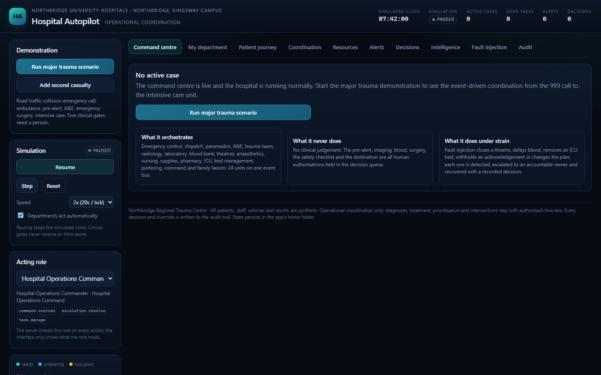

# Hospital Autopilot

**Hospital Emergency Pipeline (HRP)**: hospital resource planning between 24 departments, with a load simulation. An event-driven coordination and patient-flow prototype for a simulated major trauma centre.



Built by **Axel Kalinowski** at the [ACRYL Bootcamp](https://github.com/acrylworkshop/bootcamp-2026-11-20), Vienna, 20 November 2026.

## Run it

Node.js 22.19 or newer.

```sh
npm install
npm run dev
```

`npm run dev` opens the app inside the ACRYL frame and prints its address. The app's page is at `/autopilot` (in the frame: `/app/autopilot`). `npm start` runs the app on its own, without the frame.

The hospital is fictional: all patients, staff, vehicles and results are synthetic. The state is kept in one JSON file in the app's home, so a reload or a restart keeps the case, the audit trail and the running simulation.

## What is in it

- `plugins/autopilot/page.ts`: the command centre and the department workspaces.
- `plugins/autopilot/engine.ts`: the orchestration rules, the event queue, escalation, fault detection and the simulation clock.
- `plugins/autopilot/catalog.ts`: the hospital as data, every department, role and resource.

It is an ACRYL Blends app: [blend.yaml](blend.yaml) says which plugins it mounts, and every part is a Cordis plugin.
